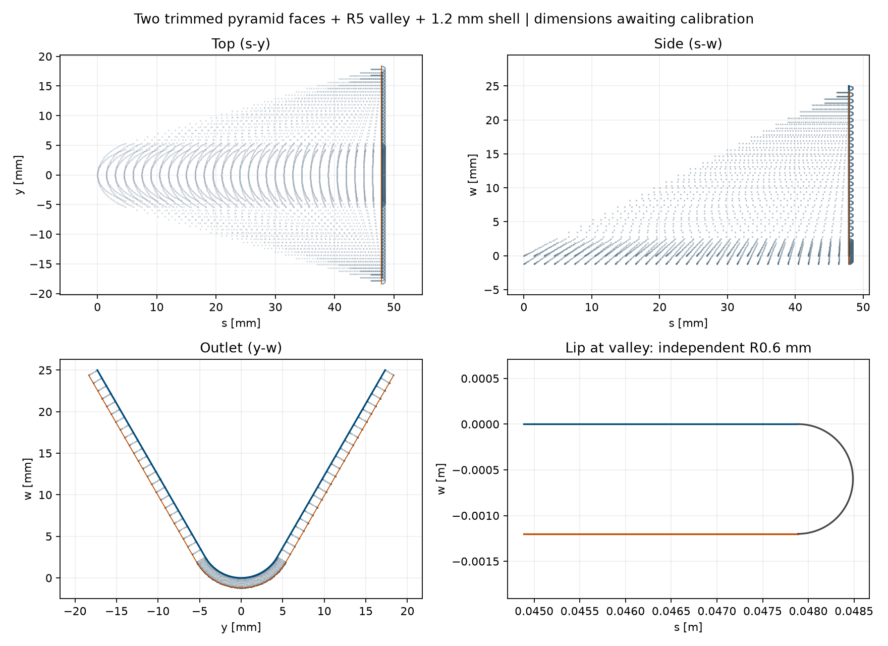
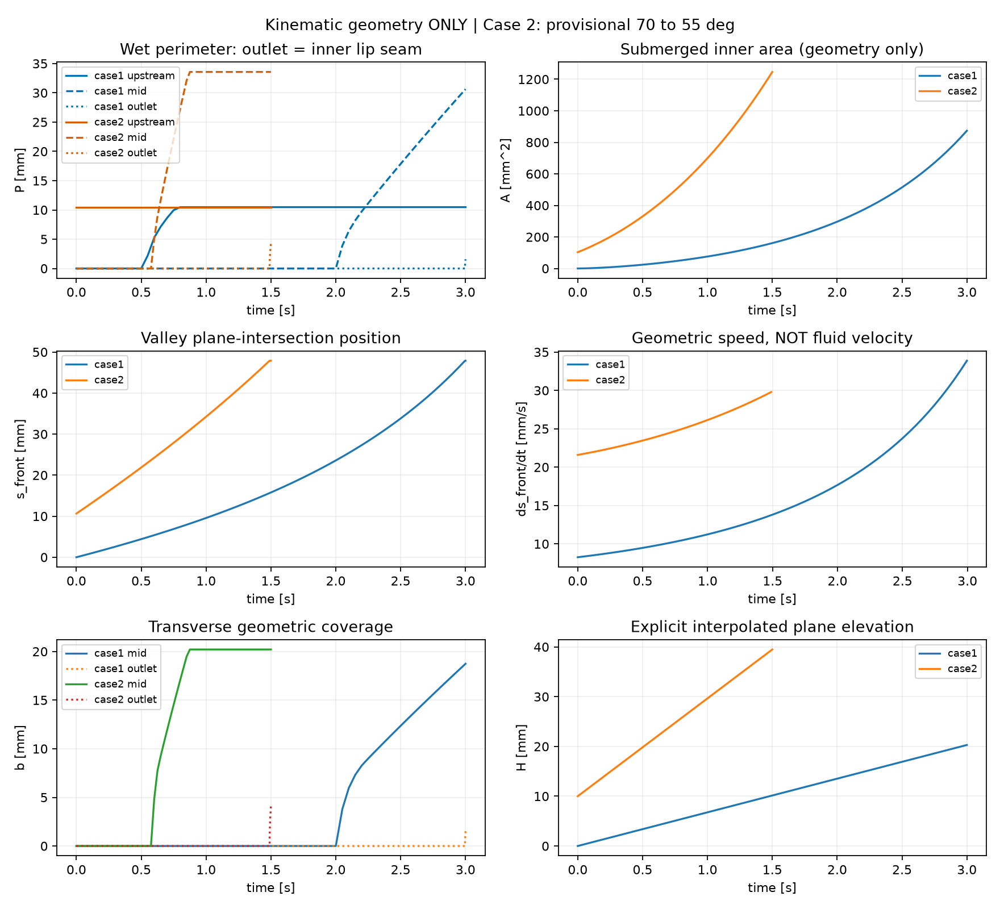
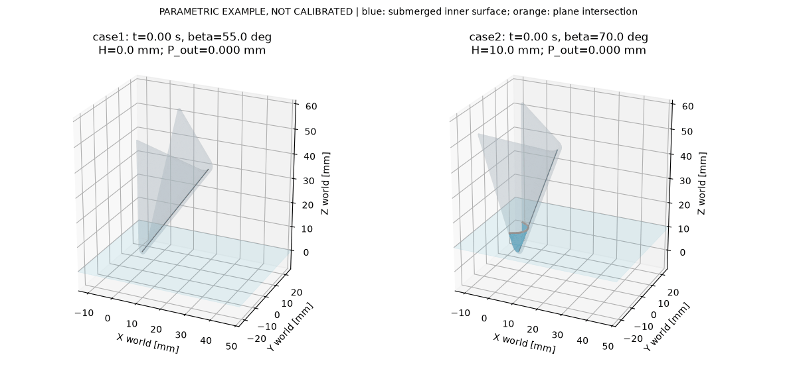
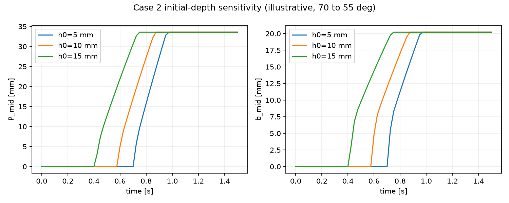

# G0/G1 本轮交付报告 — 2026-11-19

已在同一 `EVF001-g0-g1-v3` 中完成参数化三角侧面实体、运动学与水平面动态求交。
**这是可审查的几何计算，不是真实倾倒复现或 Teapot Effect 的物理证据。**
后续采用用户最新分期：G2 上游速度模型，G3 三维 VOF；本轮没有进入二者。

## 当前实体与假设

| 项目 | 当前定义 | 证据/性质 |
| --- | --- | --- |
| 两侧面 | 两个三角形斜面，中央以圆柱面相切连接 | 明确三角裁切，起点截面退化为点；非固定 V 截面挤出 |
| 中央内圆角 | R5 mm | 解析半径与相切法向测试 |
| 壁厚 | 法向 1.2 mm | 平面和圆角均检查；外圆角 R6.2 mm |
| 出口包边 | 独立 R0.6 mm 半圆 | 不与 R5 混用；内外壁相切 |
| 内夹角 | 60° | 用户暂定值，指垂直母线的横截面夹角 |
| 45 mm | 直立时圆角母线两端竖直高差 | 采用用户允许的明确解释 |
| 母线长 | 47.88799976 mm | 45/sin70° 导出 |
| 横截面出口深度 | 25 mm | 独立示例参数，非实测，非 45 mm 的替代解释 |
| 旋转中心 | 局部起点固定为世界原点 | 运动学规约，无需实物转轴 |
| 液面 | 世界水平面 H(t)，线性连接事件端点 | 显式插值，未求储水量守恒 |
| Case 2 初始水深 | 世界竖直方向 10 mm；扫描 5/10/15 mm | 示例值，全部初始已浸没 |

R5 裁掉原尖棱锥数学尖点；母线起点是剩余圆角面的起点。真实上游壶体衔接和侧缘轮廓尚未复现。
参数方程、三角面顶点、圆角和包边公式均见 [README](README.md)。



## 两组事件结果

事件 B 按**圆滑包边的最低越流门槛**定义，不按外壁最低点或出口接缝简单定义。
最低路径位于 y=0，其跨包边最高点 θ=β，门槛 `H_B=L sinβ+0.6mm(1−cosβ)`。
门槛刚接触不等于已获得有限真实出水流量。

| 指标 | Case 1 | Case 2 默认示例 |
| --- | --- | --- |
| 姿态 | 55°→25°，3 s | 暂定 70°→55°，1.5 s |
| H(0) | 0 mm | 10 mm |
| H(T) | 20.294559 mm | 39.483407 mm |
| 初始母线浸没长度 | 0 mm | 10.641778 mm |
| 末态出口接缝 P_geom | 1.576537 mm | 4.255613 mm |
| 末态出口接缝 b_geom | 1.570019 mm | 4.128260 mm |
| 末态中段 P_geom | 30.626730 mm | 33.565912 mm |
| 末态内壁浸没面积 | 873.766584 mm² | 1246.287299 mm² |
| 末态包边门槛高度余量 | 0 m | 0 m |

出口 P/b 定义在 **s=L 的内壁接缝截面**。包边门槛高出该接缝最低点，故这里出现有限小弧长；
门槛最高点本身仍刚刚相切。该区分解释了它与早期“结束时接缝刚触水、P=0”示例的差别。
后者已被用户明确的越流门槛事件替代，旧一轮示例不作为当前结果。





Case 2 深度扫描保持相同终态门槛，不同 H(0) 改变中间浸没历史。
三条曲线末态一致是**人为控制相同终态**的结果，不能解读为真实出水不受初始水量影响。



## 实际测试与产物

运行环境：项目 `.venv` Python 3.12.14、NumPy 2.5.5、Matplotlib 3.11.2、Pillow 13.0.0。
为生成图像，本轮安装 Matplotlib/Pillow 及其依赖到项目环境；未安装或运行 OpenFOAM。

实际执行命令（仓库根目录）：

```powershell
.venv/Scripts/python.exe -m unittest discover -s simulations/cfd/everyday-flows/teapoteffect/EVF001-g0-g1-v3 -p test_geometry.py -v
.venv/Scripts/python.exe simulations/cfd/everyday-flows/teapoteffect/EVF001-g0-g1-v3/verify_numerics.py
.venv/Scripts/python.exe simulations/cfd/everyday-flows/teapoteffect/EVF001-g0-g1-v3/run_all.py
.venv/Scripts/python.exe simulations/cfd/everyday-flows/teapoteffect/EVF001-g0-g1-v3/verify_artifacts.py
.venv/Scripts/python.exe -m ruff check simulations/cfd/everyday-flows/teapoteffect/EVF001-g0-g1-v3
```

- 11 项单元测试通过；没有移除有效失败测试。开发中修复了半圆侧封口的零面积三角形。
- 主 STL：9,929 顶点、19,854 三角面；每条边恰有两个相反定向邻面，Euler 特征 2；无零面积三角形，正体积。
- 解析实体体积：2.030386735×10⁻⁶ m³。圆弧/包边 16/8 → 32/16 → 64/32 → 128/64 四级细化，相对体积误差为 **0.145409%、0.036441%、0.009116%、0.002279%**，接近二阶收敛。
- 同一细化中，1 mm 液深解析圆弧湿周误差从 14.335 μm 降至 0.463 μm。
- 4 个代表时刻的内壁浸没面积与独立一维积分对照，最大相对误差 **0.028814%**，低于预设 0.2% 检查阈值。
- 68 个原有文件 SHA-256 检查：**0 改动，0 丢失**。
- 两个主 CSV 各 81 样本：61 均匀点加出口短时间窗细化（去重）；敏感性 CSV 共 183 行数据。
- ParaView 每组 21 个时间点、4 个部件，共 168 个 VTP；XML、引用和索引范围检查通过。
- 7 张 PNG 和 41 帧 GIF 全部实际解码检查，已目视检查几何图、末态三维图、曲线与敏感性图。
- Ruff 通过。完整日志与数值分别在 [artifacts](artifacts/) 下的 `*.log`、`audit.json`、`numerical_verification.json`、`artifact_verification.json`。

ParaView **文件结构已核验，未在 ParaView GUI 内打开**，不把 XML 检查冒称为 GUI 集成测试。
可直接打开 [Case 1](artifacts/paraview/case1.pvd) / [Case 2](artifacts/paraview/case2.pvd)，方法见 README。
STL 提供壶嘴局部和直立壶体坐标两个版本，均以 m 为单位。全部输出约 18 MB，没有 CFD 中间结果。

## 科学含义与当前局限

1. 角度、速度和时间约束能定义姿态，不能唯一决定 H(t)。本轮按用户授权显式插值；不需要提供储水量来完成当前运动学，但不能声称满足真实水量守恒。
2. 45 mm 的高度解释、25 mm 横截面深度、圆角起点裁切、上缘和壶体连接仍需几何审查。当前是三角侧面模型的合理参数化，不是扫描或实测 CAD。
3. 部分侧缘也被平面淹没。若它们是真实开放边缘，可能存在其他越流路径；事件 B 仅表示指定出口的门槛，当前未证明它是完整实物最先出水的位置。
4. 本轮内壁浸没区域不等于真实液体润湿范围，三维截交线不等于已求得的三相接触线，未预测外壁附水面积。
5. 纯横向轴俯仰不能在严格 y–w 截面产生任意 45°/15° 倾斜水面；草图观察面未定义，不能强行验证这两个角。
6. 几何交点速度仅在直母线段输出；越过接缝进入包边后留空，没有把直线外推速度或裁切造成的假减速当成包边前沿速度。
7. 没有流体 U、Q、压力场、膜厚、接触角动力学或 VOF 解。未预设 0.7 mm 液膜，也未把抛物线幅值当流场。
8. 解析圆弧、体积和积分对照是数值 verification；无实物测量或实验 validation。当前几何离散也不是可直接给出临界附壁阈值的 CFD 网格。

## 文件与 Git 边界

全部新增/修改均位于本 v3 文件夹。原 `kettle-spout-vof-openfoam-v2606`、任务书和其他旧文件未修改。
`EVF001-rounded-valley-v2` 和 `EVF001-rounded-V-spout-interFoam` 在本次可见目录中未找到，未假装读取或复跑。
当前分支仍为 `codex/textbook-learning-framework`；新建分支请求先前未获允许，未修改 Git 历史。
遵循用户后续要求，未提交、上传或合并，由用户自主上传 GitHub。

状态：G0/G1 **Implemented / Tested（上述限定范围）**；真实工况 **Not Validated**；G2/G3 **Planned**。
下一步是用户审查几何与事件定义，通过后再单独定义上游流动闭合；本轮不继续建立速度边界或 OpenFOAM Case。
